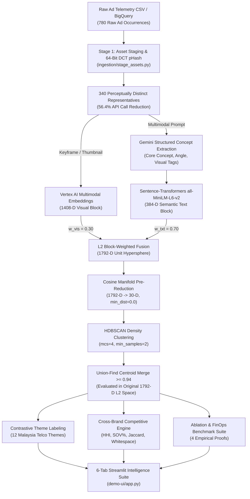

# Multimodal Creative Analytics & Competitive Intelligence Engine

[](https://www.python.org/)
[](LICENSE)
[](tests/)
[](#quick-start-zero-credential-local-portfolio-mode)
[](https://streamlit.io/)

An end-to-end multimodal machine learning and competitive intelligence platform that groups fragmented, multi-format digital advertising creatives (video & static across `9:16`, `16:9`, `1:1`, `4:5`) into unified **strategic campaign themes**, rolls up media investment and impressions, and quantifies cross-brand category positioning.

Built with a **local-first, reproducible benchmark architecture** demonstrating **Directions A + B + C**:
- **Direction A (Multimodal Creative Grouping & Spend Attribution):** Perceptual DCT deduplication (`pHash`), multimodal representation learning (1408-D visual + 384-D semantic concept blocks), manifold pre-reduction, HDBSCAN clustering, and Union-Find post-hoc centroid consolidation.
- **Direction B (Cross-Brand Competitive Intelligence):** Category-wide creative taxonomy across the **Malaysia Telecommunications (Big 4)** cohort (*Maxis / Hotlink*, *CelcomDigi*, *U Mobile*, *Unifi*), computing **Herfindahl-Hirschman Index ($HHI$)** spend concentration, **Share of Voice ($\text{SOV}\%$)**, **Jaccard Theme Overlap**, and **Strategic Whitespace vs. Category Battlegrounds**.
- **Direction C (Methodology Ablation & FinOps Benchmark Lab):** Rigorous empirical ablation against a 36-asset blind evaluation set proving 4 architectural and FinOps discoveries.

---

## Key Benchmark Results (Malaysia Telco Sector Case Study)

Running the pipeline on the **Maxis (Malaysia)** Q1 benchmark (**780 raw ad occurrences** across YouTube, TikTok, Instagram, Facebook, and Display, totaling **\$947,580** media spend) alongside the **\$2,890,700 Big 4 Malaysia Telco Category Cohort**:

| Metric / Dimension | Result | Strategic / Engineering Significance |
| :--- | :--- | :--- |
| **Perceptual Deduplication (`pHash`)** | **780 $\rightarrow$ 340** distinct renders | Eliminates **56.4%** redundant platform re-uploads before paid API calls |
| **Consolidated Creative Themes** | **12 Strategic Themes** | Consolidates `9:16` vertical & `16:9` horizontal format splits from 15 sub-clusters to 12 true propositions |
| **Unclustered Noise Spend** | **0.01% (\$95)** | Down from **23.67%** in raw 1792-D space via 30-D cosine manifold pre-reduction |
| **Blind Evaluation Accuracy** | **0.8403 ARI / 0.8942 AMI** | Scored against 36 stratified blind-labeled assets (`split_noise=True`) |
| **End-to-End Pipeline FinOps Cost** | **\$0.2202 total** (\$0.00028 / raw ad) | **87.2% cost reduction** and **12.8x speedup** vs. full-video multimodal embeddings (\$1.7202) |
| **Category Battleground Insights** | **8 Shared Pillars / 5 Exclusive Bets** | *Maxis* ($HHI=0.1590$) and *CelcomDigi* ($HHI=0.1666$) wage full-funnel convergence vs. *Unifi*'s aggressive fibre focus ($HHI=0.3007$) |

---

## System Architecture



---

## Core Mathematical Formulations

### 1. $L_2$-Normalized Block-Weighted Modality Fusion
Rather than naive concatenation (where the 1408-D visual vector would overwhelm the 384-D text vector by a $3.67\times$ dimensional imbalance), each modality block is independently $L_2$-normalized before applying explicit scalar weights $w_{\text{vis}} \in [0, 1]$ and $w_{\text{txt}} = 1 - w_{\text{vis}}$:

$$\mathbf{z}_i = \text{L2}\left(\left[\, w_{\text{vis}} \cdot \frac{\mathbf{v}_i}{\|\mathbf{v}_i\|_2} \;\;;\;\; (1 - w_{\text{vis}}) \cdot \frac{\mathbf{t}_i}{\|\mathbf{t}_i\|_2} \,\right]\right) \in \mathbb{R}^{1792}$$

Because $\|\hat{\mathbf{v}}_i\|_2 = \|\hat{\mathbf{t}}_i\|_2 = 1$, the pairwise dot product between fused representations decomposes cleanly into a convex combination of visual and semantic cosine similarities:

$$\langle \mathbf{z}_i, \mathbf{z}_j \rangle = \frac{w_{\text{vis}}^2 \cos(\mathbf{v}_i, \mathbf{v}_j) + (1 - w_{\text{vis}})^2 \cos(\mathbf{t}_i, \mathbf{t}_j)}{w_{\text{vis}}^2 + (1 - w_{\text{vis}})^2}$$

### 2. Union-Find Post-Hoc Centroid Consolidation in Original $L_2$ Space
Manifold reduction (`1792-D -> 30-D`) resolves high-dimensional distance concentration for HDBSCAN, but cleanly separates vertical (`9:16` TikTok/Reels) and horizontal (`16:9` YouTube) cuts of the same hero campaign into distinct sub-clusters. Because non-linear manifold projections distort global inter-cluster distances, post-hoc merging is computed strictly in the **original 1792-D $L_2$-normalized space**:

$$\boldsymbol{\mu}_c = \frac{\sum_{i \in C_c} \mathbf{z}_i}{\left\|\sum_{i \in C_c} \mathbf{z}_i\right\|_2}, \qquad \text{Merge}(c_a, c_b) \iff \langle \boldsymbol{\mu}_{c_a}, \boldsymbol{\mu}_{c_b} \rangle \ge \tau \quad (\tau = 0.94)$$

Connected components above $\tau = 0.94$ are resolved iteratively via Disjoint-Set Union-Find with path compression.

### 3. Competitive Concentration ($HHI$) & Share of Voice ($\text{SOV}$)
For each brand $b$ with total spend $S_b = \sum_{k} s_{b,k}$ across creative themes $k \in \{1, \dots, K\}$:

$$HHI_b = \sum_{k=1}^{K} \left(\frac{s_{b,k}}{S_b}\right)^2 \in \left[\frac{1}{K}, 1\right], \qquad \text{SOV}_{b,k} = \frac{s_{b,k}}{\sum_{b'} s_{b',k}}$$

- **Low $HHI$ ($< 0.18$):** Diversified multi-pillar portfolio (*Maxis* `0.1590`, *CelcomDigi* `0.1666`).
- **High $HHI$ ($> 0.25$):** Hero-concentrated single-proposition bet (*Unifi* `0.3007` on Home Fibre convergence).

---

## Methodology Ablation & FinOps Benchmark (4 Key Discoveries)

All claims are reproducibly verified via [`embedding-clustering/benchmark_ablation.py`](embedding-clustering/benchmark_ablation.py) and tested in [`tests/test_ablation_pipeline.py`](tests/test_ablation_pipeline.py):

### Discovery 1: Inverted Multimodal Weighting (`w_vis=0.30 / w_txt=0.70`)
Within a single advertiser (*Maxis*), distinct commercial propositions (*Postpaid Family Share*, *Home Fibre 1Gbps*, *SME Business Fibre*) share identical brand colors, typography, and studio lighting. Pure visual clustering (`w_vis=1.0`) conflates them (**0.4760 ARI**), whereas `w_vis=0.30 / w_txt=0.70` anchors clusters on commercial propositions while preserving visual layout separation (**0.8403 ARI / 0.8942 AMI**).

| Configuration | Track | $w_{\text{vis}}$ | Clusters | Noise Spend % | ARI | AMI |
| :--- | :--- | :---: | :---: | :---: | :---: | :---: |
| `Text-Only (w=0.0)` | Frame | `0.00` | 11 | 0.39% | 0.7887 | 0.8573 |
| **`Frame+Text (w=0.30)` (Champion)** | **Frame** | **`0.30`** | **12** | **0.01%** | **0.8403** | **0.8942** |
| `Frame+Text (w=0.50)` | Frame | `0.50` | 15 | 0.00% | 0.7072 | 0.7740 |
| `Frame+Text (w=0.70)` | Frame | `0.70` | 15 | 0.02% | 0.7201 | 0.7920 |
| `Frame-Only (w=1.0)` | Frame | `1.00` | 9 | 0.00% | 0.4760 | 0.6542 |
| `Video+Text (w=0.30)` | Video | `0.30` | 12 | 0.09% | 0.8403 | 0.8942 |
| `Video-Only (w=1.0)` | Video | `1.00` | 8 | 0.04% | 0.5902 | 0.7453 |

### Discovery 2 & 3: 4-Stage Architecture Ladder (30-D Manifold + Centroid Merge)
| Pipeline Stage | Clusters | Noise Spend % | ARI | AMI | Diagnostic Verdict |
| :--- | :---: | :---: | :---: | :---: | :--- |
| **1. Raw 1792-D HDBSCAN** | 15 | **23.67%** | 0.7471 | 0.7420 | High-D distance concentration strands 23.7% of media budget in `-1` noise |
| **2. 30-D Manifold + HDBSCAN** | 15 | **0.01%** | 0.7201 | 0.7920 | Rescues noise spend ($<0.01\%$), but splits `9:16` vs `16:9` hero campaigns (15 clusters) |
| **3. 30-D Manifold + Global Floor** | 10 | 0.01% | 0.7425 | 0.8227 | Global merge floor conflates distinct commercial propositions down to 10 clusters |
| **4. 30-D Manifold + Centroid Merge ($\ge 0.94$)** | **12** | **0.01%** | **0.8403** | **0.8942** | **Champion:** Consolidates multi-format splits (`15 -> 12`) with peak ARI/AMI |

### Discovery 4: Keyframe vs. Full-Video FinOps Pareto Frontier
| Pipeline Architecture | Total API Cost (340 Reps) | Cost per Raw Ad | Mean Latency / Asset | Clustering ARI |
| :--- | :---: | :---: | :---: | :---: |
| **Keyframe / Thumbnail + Text (`w_vis=0.30`)** | **\$0.2202** | **\$0.00028** | **1.05s** | **0.8403** |
| **Full Video Multimodal + Text (`w_vis=0.30`)** | \$1.7202 | \$0.00221 | 13.44s | 0.8403 |
| **Savings / Efficiency Gain** | **87.2% Cheaper** | **7.8x Lower Unit Cost** | **12.8x Faster** | **Identical Accuracy** |

---

## Repository Structure

```text
creative-analytics-grouping/
├── config.py                          # Multi-profile configuration loader (CREATIVE_CONFIG_PROFILE)
├── run_pipeline.py                    # 8-stage pipeline orchestrator with --dry-run & --force
├── configs/
│   ├── maxis_my.yaml                  # Primary benchmark profile: Maxis Malaysia (780 raw -> 340 reps)
│   ├── malaysia_telco_category.yaml   # Category cohort profile: Maxis, CelcomDigi, U Mobile, Unifi
│   └── template.yaml                  # Sanitized template for custom brand onboarding
├── scripts/
│   └── generate_synthetic_portfolio.py # Deterministic generator for all datasets, embeddings & JPEG cards
├── common/
│   ├── vectors.py                     # L2 normalization, block fusion, manifold reduction, Union-Find merge
│   ├── costs.py                       # FinOps cost ledger & SKU rate calculator
│   └── logging.py                     # Structured JSON & console logging
├── ingestion/
│   ├── stage_assets.py                # Media staging, ffprobe metadata, & 64-bit DCT pHash deduplication
│   ├── process_assets.py              # Async Gemini concept enrichment & retry orchestration
│   └── ad_analyser/                   # Pydantic schemas & multimodal Gemini prompt templates
├── embedding-clustering/
│   ├── cluster.py                     # UMAP/Manifold 30-D + HDBSCAN + Centroid Merge + Theme Labeling
│   ├── competitive.py                 # Cross-brand HHI, SOV%, Jaccard overlap & whitespace engine
│   ├── benchmark_ablation.py          # 4-discovery ablation & FinOps benchmark suite
│   ├── evaluate.py                    # Blind evaluation scorer (ARI / AMI with split_noise)
│   ├── fix_oversplit.py               # Centroid cosine similarity inspection utility
│   └── tune.py                        # Hyperparameter Pareto frontier sweep
├── demo-ui/
│   ├── app.py                         # 6-tab Streamlit Executive & Competitive Intelligence Dashboard
│   ├── aggregate.py                   # Spend & impression rollup verification
│   ├── insights.py                    # Automated Markdown executive briefing generator
│   ├── export.py                      # Multi-page PDF executive report generator
│   └── data/                          # Pre-computed CSV/JSON/PDF artifacts for zero-key launch
├── evaluation/
│   ├── eval_labels.json               # 36 blind-tagged ground-truth evaluation labels
│   ├── ablation_report.json           # Full JSON output of the 4 ablation experiments
│   ├── cluster_review.html            # Self-contained HTML cluster inspection sheet
│   └── eval_sheet.html                # Interactive blind human-tagging HTML tool
└── tests/                             # 19 pytest unit & integration tests
```

---

## Quick Start (Zero-Credential Local Portfolio Mode)

This repository ships with a complete, deterministic synthetic benchmark for the **Malaysia Telecommunications sector** (including rendered creative cards in `assets/frames/*.jpg`, pre-computed multimodal embeddings, and competitive intelligence tables) so you can run the entire clustering, competitive analysis, ablation suite, and Streamlit UI **100% offline without GCP credentials**.

### 1. Install Dependencies

```bash
pip install -r requirements.txt
```

### 2. Launch the 6-Tab Streamlit Intelligence Suite

```bash
streamlit run demo-ui/app.py
```

The interactive dashboard includes **6 specialized views**:
1. **Executive Overview:** Portfolio KPIs (`780 -> 340 -> 12`), top-theme spend distribution, and automated executive narrative.
2. **2D Semantic Cluster Explorer:** Interactive manifold projection sized by media spend with creative card previews and format-consolidation badges.
3. **Ranked Creative Themes:** Sortable rollup table with media format splits (`9:16` vs `16:9`) and spend concentration diagnostics.
4. **Malaysia Telco Competitive Intelligence (Big 4):** Cross-brand $HHI$ cards, **100% Stacked Share-of-Voice ($\text{SOV}\%$) Battleground vs. Whitespace chart**, and **Pairwise Jaccard Theme Overlap matrix**.
5. **Methodology & Ablation Lab:** Interactive visualizations of the **Modality Weight Curve (`w_vis` 0.0 $\rightarrow$ 1.0)**, the **4-Stage Architecture Ladder**, and the **FinOps Cost-Accuracy Pareto Frontier**.
6. **Unclustered Noise Audit:** Inspection of the `< 0.1%` unclustered outlier spend.

### 3. Regenerate All Benchmark Artifacts or Run the Orchestrator

```bash
# Regenerate synthetic portfolio data, embeddings, and creative JPEG cards
python scripts/generate_synthetic_portfolio.py

# Check pipeline cache status (all 8 stages)
python run_pipeline.py --dry-run

# Re-run clustering, competitive intelligence, and ablation benchmarks
python embedding-clustering/cluster.py
python embedding-clustering/competitive.py
python embedding-clustering/benchmark_ablation.py
```

### 4. Run the Automated Test Suite

```bash
pytest tests/ -v
```

---

## License

This project is licensed under the [Apache License, Version 2.0](LICENSE).

