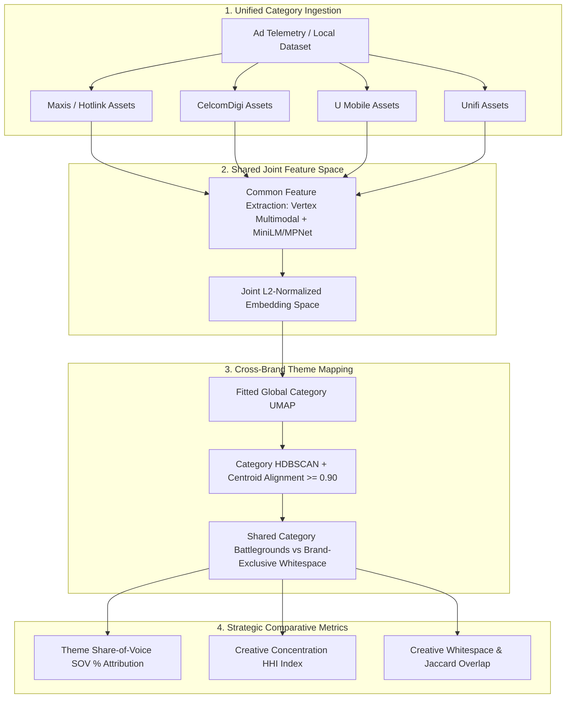

# Competitive Creative Intelligence Architecture (Malaysia Telco Category)

## 1. Overview & Objective
The Competitive Intelligence Engine (`embedding-clustering/competitive.py`) extends the single-advertiser creative clustering pipeline to **cross-advertiser category intelligence**. It enables marketing strategists and media planners to analyze category-wide creative maneuvers across Malaysia's Big 4 Telecommunications providers (**Maxis**, **CelcomDigi**, **U Mobile**, and **Unifi**).

---

## 2. Architectural Pillars

---

## 3. Mathematical Formulations & Strategic Metrics

### 3.1 Joint Normalized Embedding Space
- **Problem**: Projecting each advertiser into independent embedding spaces makes cosine distance comparisons invalid across runs.
- **Solution**:
  - Fix the visual encoder to Vertex `multimodalembedding@001` (`1408-D`) and text encoder to `all-MiniLM-L6-v2` (`384-D`) or `all-mpnet-base-v2` (`768-D`).
  - Normalize blocks with the $L_2$ metric prior to weighted concatenation ($w_{\text{vis}} = 0.3, w_{\text{txt}} = 0.7$).
  - Project all category representatives into a unified global UMAP manifold so geometric coordinates $(x, y)$ are directly comparable across competitors.

### 3.2 Cross-Brand Theme Alignment & Classification
- **Shared Category Battlegrounds**: When multiple telcos run campaigns around the same core consumer proposition (e.g., *5G Postpaid Unlimited Family Share*, *1Gbps Home Fibre + WiFi 6*, *Flagship 5G Smartphone RM1 Instalment*, or *Festive Raya/CNY 5G Roaming*), their centroid cosine similarity in the joint space exceeds $\tau \ge 0.90$.
- **Brand-Exclusive Whitespace Angles**: Clusters with zero overlap from competitors represent differentiated proprietary propositions (e.g., Maxis's *Home Solar Rooftop Subscription* & *AI Cyber Guard*, Unifi's *Unifi TV Sports & Asian Drama Pack*, or U Mobile's *RM19 Campus Student 5G Entry Plan*).

### 3.3 Quantitative Portfolio Indices
1. **Creative Concentration Index (Herfindahl-Hirschman Index — $HHI$):**
   $$HHI = \sum_{i=1}^{N} s_i^2, \quad \text{where } s_i = \frac{\text{Spend}_i}{\sum_{j=1}^{N} \text{Spend}_j}$$
   - $HHI < 0.19$: **Balanced Multi-Pillar Convergence** (broad investment across Postpaid, Fibre, Devices, B2B, and Adjacent Tech).
   - $HHI \ge 0.24$: **Hero-Concentrated Posture** (heavy reliance on 1–2 hero acquisition campaigns).
2. **Theme Share of Voice ($\text{SOV}_b^{(k)}$):**
   $$\text{SOV}_b^{(k)} = \frac{\text{Spend}_{b, k}}{\sum_{m \in \mathcal{B}} \text{Spend}_{m, k}} \times 100\%$$
3. **Creative Theme Overlap Index (Jaccard Similarity):**
   $$J(A, B) = \frac{|\mathcal{T}_A \cap \mathcal{T}_B|}{|\mathcal{T}_A \cup \mathcal{T}_B|}$$
